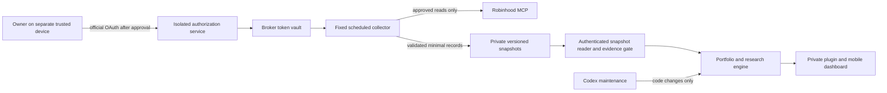

# Independently enforced portfolio gateway

Design revision: 2026-11-05. Status: **design and mock policy tests only**.
No hosting, isolation, OAuth client, broker credential or real portfolio is connected.
The user's latest instruction replaces the earlier native-read-only-scope prerequisite.

## Decision

Prefer a separately administered **scheduled collector and private snapshot reader**
over a live agent-to-broker proxy. Both can restrict downstream operations, but the
snapshot design removes agent requests from the credential-bearing execution path.
The collector runs a fixed job, never a model-generated script or tool selection.
Codex maintains research/UI code; a human separately controls releases of the
credentialed collector, reader policy and their infrastructure.

**Broker-enforced read-only authorization** means Robinhood itself refuses mutations
for the credential. **Gateway-enforced read-only access** means our independently
controlled software permits only approved reads, while the upstream token may be
capable of more. We propose the latter, pending consent and isolation verification.
We must never label its upstream token read-only.

There is no plugin-to-collector or agent-to-vault arrow. The reader cannot refresh
the broker, execute arbitrary HTTP/MCP calls, or change collector configuration.
An on-demand investment question uses the latest dated snapshot; stale evidence
produces a missing-data response, not an implicit refresh or guessed allocation.

## Concrete deployment proposal

Use a **separate owner-administered AWS account**, with no credentials, console
session, federation trust or deployment integration exposed to Codex. This is a
reference design, not a provisioned service or verified cost estimate. No paid
resources are created by this work. Before provisioning, compare actual usage
costs and present the final resource policy and billable services to the owner.

| Component | Proposed service and narrowly permitted access |
| --- | --- |
| OAuth onboarding | Separate owner-only callback function; exact registered redirect, PKCE S256, state/session binding; writes token only to one secret |
| Token vault | Secrets Manager; only onboarding and collector runtime roles may access the broker secret; encrypted backups remain outside agent access |
| Collector | Published Lambda version on a fixed EventBridge schedule; reads/refreshes one token, reads a fixed approved-account mapping, writes only its private snapshot/health prefix |
| Snapshot storage | Private S3 bucket, public access blocked, encryption and versioning; no bucket listing or source artifacts exposed publicly |
| Snapshot reader | Separate Lambda/API service with owner authentication and only `GetObject` on approved snapshot/health objects; cannot get broker secrets or invoke the collector |
| Integrity | Collector-controlled signing key or equivalent authenticated producer provenance; reader verifies owner, version, source times, schema, coverage and signature |
| Research/UI | Existing private plugin consumes only the reader's narrow API; any reader credential has no broker or cloud-administration rights |
| Maintenance | GitHub contains code and mock fixtures only. No GitHub secret/OIDC role/build webhook can publish collector code, change its roles, or update a mutable image used by it |

The collector execution role needs secret read plus token-refresh persistence and
snapshot writes; these are infrastructure writes, **not financial mutations**.
Its role cannot change IAM, attach layers, alter Lambda code/configuration, invoke
arbitrary functions, manage signing keys, or grant itself permissions. The reader
role has no such secret access. Cloud administrators can still change these
controls; their isolation and trust are part of the security boundary.

AWS documents [separate execution roles](https://docs.aws.amazon.com/lambda/latest/dg/lambda-intro-execution-role.html),
[runtime secret retrieval](https://docs.aws.amazon.com/lambda/latest/dg/with-secrets-manager.html)
and [resource/action-scoped object policies](https://docs.aws.amazon.com/AmazonS3/latest/userguide/access-policy-language-overview.html).
Those mechanisms support the proposal; they do not prove our effective IAM or
network configuration. Do not copy secret-printing examples into this project.

## Control-plane and desktop isolation

The current Codex session has unrestricted local filesystem and network access.
It can edit this repository and deploy the existing Site. An environment variable,
local file permissions, encrypted local token with an accessible decryptor, Docker
container, hidden MCP tool, or Site secret does not stop that same agent from
replacing code or obtaining the credential. The existing Site must never hold a
Robinhood token, even if its UI is owner-private.

A separate cloud account also does not protect an existing logged-in Robinhood
browser, cloud-admin console or keychain reachable from this desktop. We have not
inspected credentials or authenticated browser sessions to test that risk. Before
activation, use an independently restricted agent OS identity or managed cloud
environment with no owner-browser/CUA/remote-desktop route, broker app session,
password store, admin CLI credentials, signing key, elevated helper or deployment
principal. The owner uses a separate trusted device for broker/admin sign-in.
Restrictions must be controlled outside the agent's writable configuration.

The owner/admin must also check alternate access through connected plugins,
GitHub Actions, reusable workflows, package publishing, mutable container tags,
cloud role assumption/PassRole, resource-policy edits, build services, backups,
debug dumps and secret-reading monitoring tools. No privileged self-hosted CI runner
may execute code the agent can push. Approved releases pin code/dependency digests;
a change in this public repo is not permission to promote it.

OpenAI's [permission documentation](https://learn.chatgpt.com/docs/permissions)
states that Full Access removes local sandbox restrictions and that command
network rules do not cover every plugin/browser surface. These controls need
separate evaluation. The current setup therefore **does not yet meet independent
isolation**. This is a control-plane blocker, not a missing-OAuth-scope argument.

## Data-plane policy

The internal contract has four fixed reads: accounts, balances, holdings and
transaction history. It uses approved account aliases, bounded date/page ranges,
fixed destinations and typed parameters. It accepts no arbitrary URL, HTTP method,
headers, MCP method/tool, code, callback, account number or configuration from an
agent. Unrecognized operations and arguments are denied before any upstream call.
No wildcard `get_*` rule or dynamically discovered tool is automatically approved.

Candidate upstream tools include `get_accounts`, `get_portfolio` and
`get_equity_positions`. Exact argument/output schemas and complete transaction
coverage are **not verified**, so no production adapter exists. Order history or
`get_pnl_trade_history` alone is not a complete cash-flow ledger. Unknown deposits,
withdrawals, fees, dividends, splits, transfers and IRA tax-year data stay missing.

The live collector's eventual outbound adapter must construct only approved read
requests to exact vendor-reviewed endpoints. Redirects, remote pagination URLs,
MCP elicitation callbacks, sampling, executable resources and newly advertised
tools are not followed automatically. Account enumeration is filtered inside the
isolated service; only the owner's approved account aliases leave it. Bounds,
timeouts and rate limits must also prevent resource-exhaustion or refresh abuse.

All orders, cancellations, exercises, deposits, withdrawals, transfers, recurring
purchases and other financial mutations are absent and denied. A deny-list is
supplementary; the small exact allowlist is authoritative. The agent cannot reach
a generic credentialed proxy. Direct access to the public Robinhood hostname does
not supply a usable credential; separate agent-session isolation closes other
authenticated bypasses. An egress firewall is additional protection, not a
substitute for validating MCP request bodies sharing the same endpoint.

## Authentication and actual permissions

See [the current authorization review](GATEWAY_AUTH_REVIEW.md). Public metadata
advertises authorization-code/refresh-token grants, S256 PKCE and `internal` scope.
It does not enumerate that scope's exact authority. Official documentation describes
all-account reads and trading on a dedicated Agentic account. A hosted custom
client/redirect and onboarding without opening that account are not yet verified.

Before the user authorizes an account, present the chosen deployment, exact client
identity and callback, requested scope, actual consent wording, broker-confirmed
effective read/mutation/account coverage, token lifetime/rotation/revocation behavior
and downstream allowlist. If these facts cannot be established, explicitly leave
them unknown and do not request the grant. A consent screen can be reviewed without
accepting it, on the owner's trusted device; passwords/codes/tokens never enter chat.
Use only the vendor-supported OAuth flow; no password API, cookie scraping or
import of the owner's browser token. This turn authorizes none of those steps.

## Evidence, privacy and recommendations

Publish a new private immutable snapshot only after schema/coverage validation,
including source observation time, collection time, account coverage, page
completeness, stable event identity and reconciliation. These times are distinct.
Current balances/positions may be usable descriptively before complete history,
but performance is unavailable until the ledger is complete and reconciled.
An authenticated broker response is not proof that all historical activity arrived.

The authoritative reader must independently reject unknown producers, altered
signatures, mismatched account scope, replayed/out-of-order versions, stale or
future dates, incomplete pages and failed refresh status. Preserve the last good
snapshot only as dated history; never relabel it current. A downstream process
cannot submit its own `verified: true` field to bypass this gate.

The existing deterministic accounting, evidence policy and recommendation checks
remain required. Current portfolio evidence alone does not supply valuation,
fundamentals, research sources, Roth room or taxable lots. Recommendation readiness
stays blocked until the relevant evidence is available. Sources are data, not
instructions. Conversational adherence still needs regression evaluation.

No personal data in Git, public CI, release archives or bundled HTML. Private
runtime objects use aliases and minimal structured fields; drop account numbers,
tokens, raw OAuth/MCP messages and unnecessary personal identifiers. Application
logs contain only operation/status codes, timings and nonidentifying counters.
Disable HTTP body/header capture, debug dumps and financial-data tracing. Review
the hosting provider's default request logs and private backup retention before use.
Proposed raw response retention is memory-only; retain normalized ledger/report
history privately for accounting, with owner-controlled deletion and backup policy.

## Residual risk and maintenance

A compromised collector, malicious dependency, policy bug, stolen token, trusted
admin compromise or broker-side behavior change can expose the upstream token's
broader authority. Independent isolation limits what Codex can cause; it does not
make the upstream token incapable of trading. If that residual risk is unacceptable,
use a broker-enforced read-only grant or manual exports instead. Approval-on settings
and an unfunded trading account can reduce some risk but do not establish read-only.

Research/UI maintenance can remain automated within its own permissions. Collector
code, authorization, IAM, secrets, OAuth metadata changes and policy changes require
separate owner-controlled release review. Monitor read failures, expired/revoked
tokens, missed snapshots and schema drift using sanitized health alerts. Do not
expand permissions or silently switch to a fallback credential to repair a failure.

## Activation evidence and closest alternative

1. Review supported OAuth/consent permissions and account-creation requirements.
2. Establish the separate admin/agent identities and owner-controlled release path.
3. With **fake credentials and a mock broker only**, test allowed reads and every
   mutation, raw relay, alternate path, redirect and secret-echo denial. Verify zero
   mock broker calls for denied operations.
4. Test effective cloud IAM with canary resources and policy inspection: agent/read
   principal cannot read a canary secret, invoke the collector, update function code,
   alter environment/layers, assume/pass its role, edit IAM/storage policy, replace
   signing keys or publish through GitHub. Never attempt a real financial transaction.
5. Independently inspect artifacts, logs and permission boundaries. Mock unit tests
   do not prove deployment isolation; a self-attestation boolean cannot enable live mode.
6. Only after the user reviews the concrete evidence and explicitly authorizes linking,
   complete official Robinhood sign-in. Verify genuine reads, page completeness,
   timestamps/reconciliation and mobile retrieval without granting agents broker access.

If custom hosted OAuth is unsupported, a collector on a **separate trusted machine**
outside Codex control may use an officially supported localhost flow, subject to
vendor confirmation. It publishes the same private snapshots. If neither independent
host nor restricted agent environment is available, use the existing protected manual
import path. A same-Mac proxy under this session's access level is not the alternative.

The mock kernel in `src/investment_research/gateway.py` implements internal read
dispatch and data validation only. It contains no network, OAuth, secrets, live
adapter or production activation flag. It cannot certify IAM, owner authentication,
host isolation, broker permissions or recommendation readiness.
